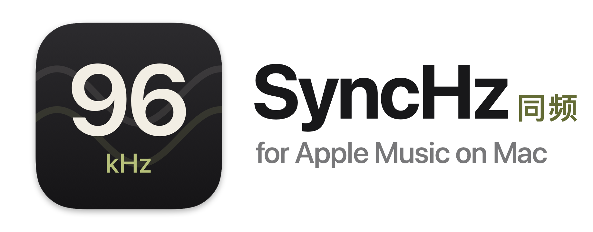
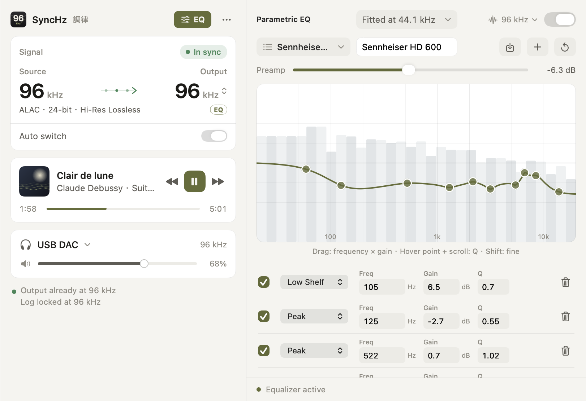
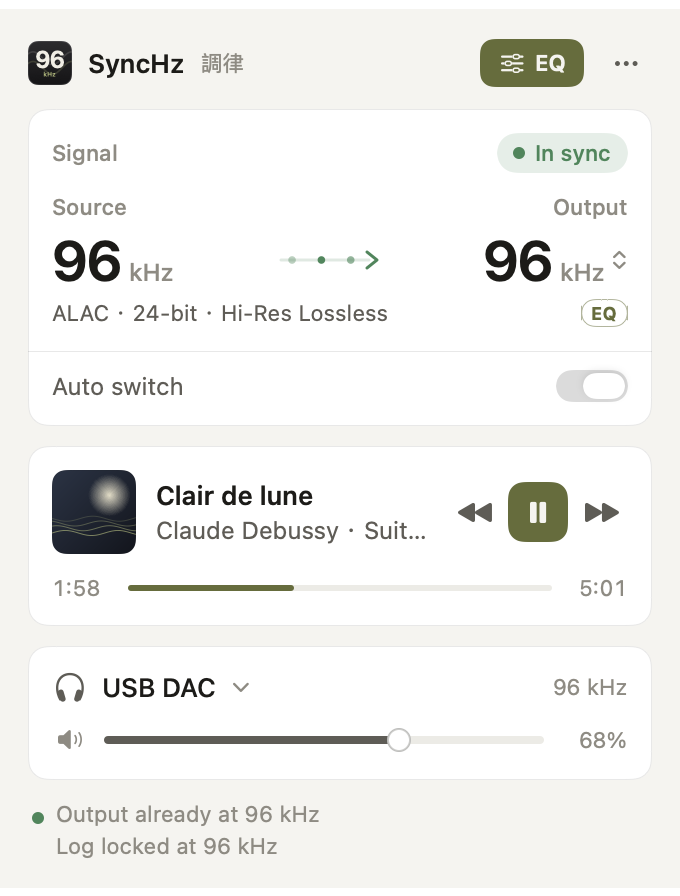
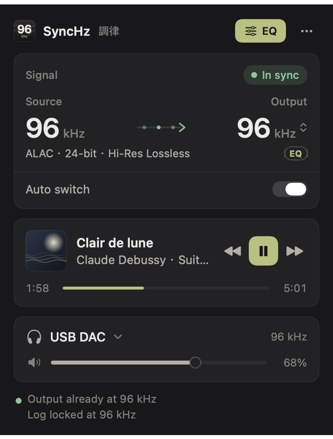
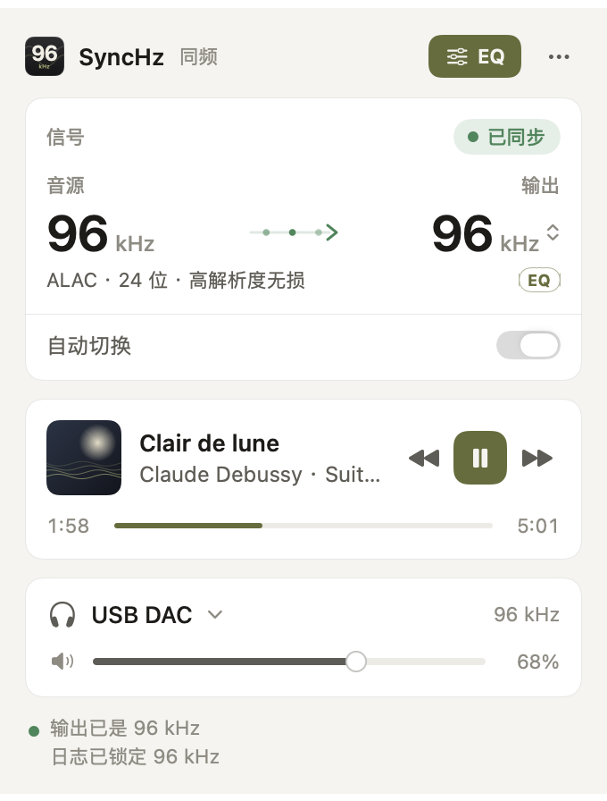
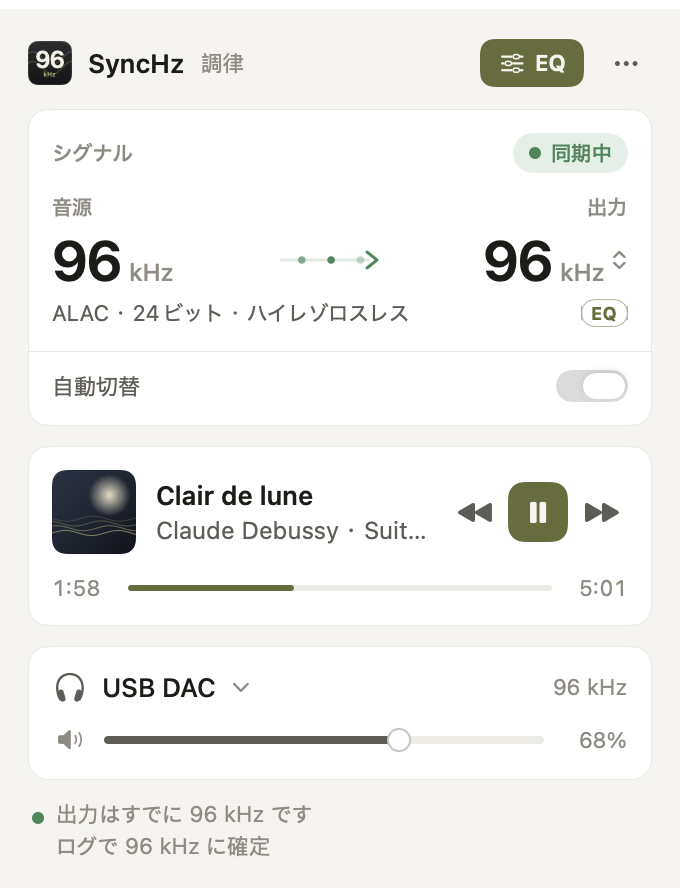
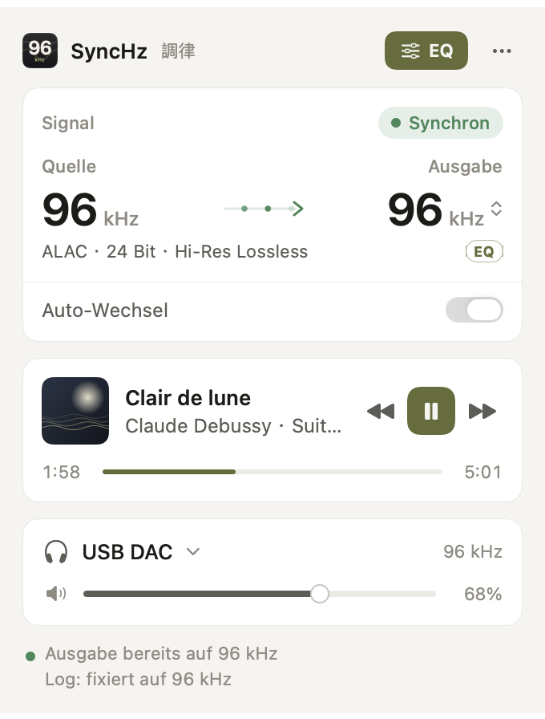
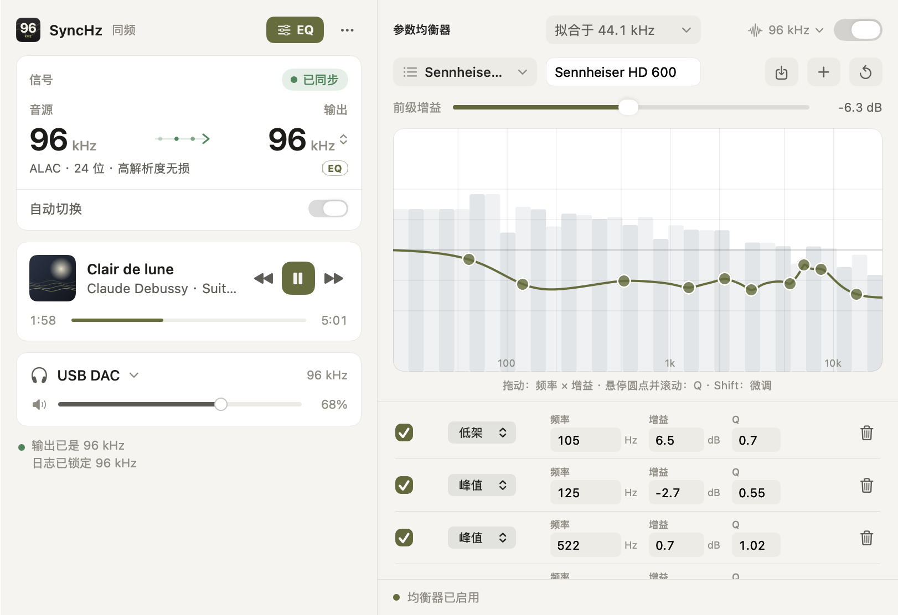

<p align="center">
  <picture>
    <source media="(prefers-color-scheme: dark)" srcset="branding/banner-dark.png">
    
  </picture>
</p>

<p align="center">
  <b>Automatic lossless sample-rate switching and headphone EQ for Apple Music on Mac.</b><br>
  Your DAC follows every track, 44.1 kHz to 192 kHz, so Hi-Res Lossless plays bit-perfect.
  When you want it, a parametric EQ that reads AutoEq and PEQdB presets.
</p>

<p align="center">
  <a href="https://github.com/jcongaku/apple-music-lossless-eq/releases/latest"><b>Download for Mac</b></a>
  &nbsp;·&nbsp;
  <a href="https://jcongaku.github.io/apple-music-lossless-eq/">Website</a>
  &nbsp;·&nbsp;
  <a href="#中文简介">中文</a>
</p>

<p align="center">
  
  
  
  
</p>

<p align="center">
  <picture>
    <source media="(prefers-color-scheme: dark)" srcset="docs/screenshots/hero-dark.png">
    
  </picture>
</p>

**SyncHz** (同频, formerly Choritsu) is a free, open-source menu-bar app **for Apple Music on macOS**. Apple Music streams Lossless and Hi-Res Lossless at 44.1, 48, 88.2, 96, 176.4 and 192 kHz, but macOS leaves your output device at one fixed rate and quietly resamples everything else. SyncHz reads the rate of the track Apple Music is actually decoding and switches your DAC, headphone amp or USB interface to match within about a second, the same job [LosslessSwitcher](https://github.com/vincentneo/LosslessSwitcher) pioneered, rebuilt for macOS 15 Sequoia and macOS 26 Tahoe. On top of that sits an optional headphone **parametric EQ** that imports AutoEq and PEQdB presets. No virtual audio driver, no admin rights, no kernel extension.

## Why I built it

My Apple Music goes to four headphones: a HiFiMAN Susvara, a Sennheiser HD 800 S, an HD 600, and a pair of JVC HA-FW10000 in-ears for when I leave the desk. Each one gets its own AutoEq correction. Two things kept bugging me.

The first was silent resampling. Apple Music would say *Hi-Res Lossless, 24-bit/96 kHz*, and Audio MIDI Setup would say *48 kHz*. Nothing told you the difference.

The second was EQ. Every way of equalising Apple Music meant a virtual audio driver, an admin install, or giving up the Music app. I wanted a correction that follows the music, switches with the headphones I pick up, starts in one click and goes away just as cleanly.

So SyncHz does two things. It keeps the output locked to whatever Apple Music is really decoding, and when I ask, it lays a measured headphone correction on top. It lives in the menu bar and it is built to disappear.

## What it does

- **Lossless sample-rate switching for Apple Music.** Matches the output device to the current track: 44.1, 48, 88.2, 96, 176.4 or 192 kHz. Debounced, so it never flaps mid-track. The panel shows source and output side by side, plus the codec, bit depth and Apple's quality tier (*ALAC · 24-bit · Hi-Res Lossless*).
- **Headphone EQ that speaks AutoEq and PEQdB.** Import a `ParametricEQ.txt` from AutoEq, a PEQdB export or any Equalizer APO file. Up to 32 bands: peaks, low and high shelves. Drag the curve, scroll to set Q, keep a profile per pair of headphones. A live piano-key spectrum sits behind the curve.
- **Correct at every sample rate.** EQ generators fit their filters at one rate. SyncHz re-fits each band to the rate that is playing, so a preset measures the same at 44.1 and at 192 kHz (more on that below).
- **Follow the track, or hold 48 kHz.** By default the EQ runs at the track's own rate. If your DAC prefers one fixed rate, hold it at 48 kHz and let Core Audio convert.
- **Now playing and transport.** Artwork, title, progress, play/pause and skip from the menu bar.
- **Output device and volume.** Switch the system output, ride its hardware volume, or override the rate by hand like Audio MIDI Setup.
- **12 languages.** English, 简体中文, 繁體中文, 日本語, 한국어, Deutsch, Español, Français, Italiano, Nederlands, Português (Brasil) and Русский, switchable live from the ⋯ menu.

## Notes from the workbench

### A PEQ on Apple's Accelerate, in double precision

The first EQ engine was a hand-written transposed direct-form II biquad cascade in Swift, one sample at a time. It was accurate, and it cost about 10% of a CPU core for 16 bands of stereo at 192 kHz. A menu-bar app has no business spending that.

It now runs on **`vDSP_biquadD`** from Apple's Accelerate framework: the whole cascade, every channel, a block of up to 1,024 frames per call, vectorised on the CPU's SIMD units. I benchmarked the options on 10 seconds of 192 kHz stereo through 16 sections, against a high-precision reference:

| Engine | CPU (one Apple Silicon core) | Error vs reference |
|---|---:|---:|
| Swift, per-sample, `Double` | 10.1% | −152 dB |
| `vDSP.Biquad<Float>` | 0.61% | **−11 dB, unusable** |
| **`vDSP_biquadD` (SyncHz today)** | **0.55%** | −152 dB |

The surprise was the `Float` row. It is just as fast, and wrong: low-frequency, high-Q bass filters have poles so close to the unit circle that single-precision coefficients cannot place them. Headphone presets are full of exactly those filters. So the core stays in `Double` while the audio buffers stay `Float`. The −152 dB floor is the `Float` output itself, far below anything a DAC can reproduce. (`vDSP_deq22D` also works, but in my tests it was slower than the biquad call on Apple Silicon.)

Accelerate is fast, but it has no idea it is running on a real-time audio thread, so the plumbing around it matters:

- **No locks, no allocation on the audio thread.** A new preset is built on a control queue and handed over through a single atomic pointer swap. The old filter setup goes to a retired list and is freed off the audio thread.
- **Click-free changes.** Two filter banks run side by side for 20 ms and crossfade whenever you edit a band. Turning the EQ on or off ramps over 5 ms.
- **Filter state survives block boundaries.** History is kept in the delay layout vDSP expects, so blocks join seamlessly. Tests check this against the reference to better than 10⁻⁶.
- **A safety net.** A NaN resets the filter state instead of hissing forever, the output is clamped before it reaches your DAC, and automatic headroom keeps boosts from clipping.

Under Rosetta the same engine measures 0.96% of a core. The idle cost is lower still: the spectrum and the panel's animations stop drawing as soon as the panel is hidden.

### Speaking AutoEq and PEQdB fluently

[AutoEq](https://github.com/jaakkopasanen/AutoEq) and [PEQdB](https://peqdb.com/) export a list of filters (type, frequency, gain, Q) and leave the maths to whoever applies them. Get a convention slightly wrong and a correction that measured flat on the generator's side ends up a decibel or two off on yours. SyncHz follows the generators exactly:

- **Same filters.** Peaks and shelves are RBJ Audio EQ Cookbook biquads, the ones both generators use. Shelves take Q in the cookbook's own definition, with the corner at the half-gain point.
- **Same files.** `PK`, `LSC`, `HSC` and `LS`/`HS`, Equalizer APO's `BW Oct` bandwidths, glued units (`105Hz`), comma decimals and multiple `Preamp:` lines all parse. Tests pin the coefficients to cookbook reference values and run a real published AutoEq preset end to end.
- **Same design rate.** This is the subtle one. A biquad's response depends on the sample rate, and generators fit at a single rate: AutoEq's published presets at 44.1 kHz, PEQdB at 48 kHz. Play the same numbers at 96 or 192 kHz and the top octave drifts, by about 1.9 dB on a typical AutoEq preset and by up to 4.3 dB on real PEQdB presets.

Because SyncHz follows every track's rate, it can't ignore that. Each band is **re-fitted at the playback rate** to the response it had at its design rate: a closed-form RBJ starting point, refined with Levenberg-Marquardt. When one section cannot follow, as with a high shelf that bends near Nyquist, the band is split into two. Across a real AutoEq preset and five real PEQdB presets the error drops to **≈0.04 dB at 96 and 192 kHz**. Each fit is cached, so a rate change costs nothing audible. The EQ panel shows which design rate a profile is fitted at (*Fitted at 44.1 kHz*) and lets you change it for presets from other tools.

### Tapping Apple Music without a driver

The EQ uses the Core Audio process-tap API that arrived in macOS 14.4: a *muted* tap on Apple Music feeds a private aggregate device, the filters run there, and the result goes to your real output. A few things I learned so you don't have to:

- Ask for a tap on the **device's own stream**, not the stereo mixdown. The mixdown is pinned to 48 kHz and quietly resamples a 96 kHz track before you ever see it.
- In the aggregate device, the tap's stream comes **after** the sub-device's own inputs. A DAC with a microphone input will otherwise hand you silence.
- A hardened-runtime app needs the **audio-input entitlement**, even though nothing is recorded. Without it macOS denies the tap without saying so, and Apple Music, already muted, goes silent.

When the EQ is on, playback is no longer bit-perfect, and the panel says so. When it is off, SyncHz is out of the signal path entirely. It only changes the setting you could change in Audio MIDI Setup.

## How it reads the sample rate

macOS has no supported API for "the sample rate of the track that is playing", so SyncHz cross-checks three sources, in order of trust:

1. **Apple Music's own log.** The Music app logs the format of the stream it is decoding. SyncHz tails the unified log, snaps candidates to standard rates and locks one only after enough evidence. The lock resets on every track change.
2. **MediaRemote**, the private now-playing framework. Best-effort on recent macOS.
3. **AppleScript to Music.app**, the dependable fallback for metadata, artwork and transport.

## Screenshots

<table>
  <tr>
    <td align="center"><br><sub>Light</sub></td>
    <td align="center"><br><sub>Dark</sub></td>
    <td align="center"><br><sub>简体中文</sub></td>
  </tr>
  <tr>
    <td align="center"><br><sub>日本語</sub></td>
    <td align="center"><br><sub>Deutsch</sub></td>
    <td align="center"><br><sub>EQ, 简体中文</sub></td>
  </tr>
</table>

## Install

1. Download the latest `.dmg` from [Releases](https://github.com/jcongaku/apple-music-lossless-eq/releases/latest) and drag **SyncHz** into Applications.
2. SyncHz is not notarized yet, so macOS will refuse the first launch. Clear the quarantine flag once:
   ```bash
   xattr -dr com.apple.quarantine /Applications/SyncHz.app
   ```
3. Open it from the menu bar and play something in Apple Music.

Requires macOS 15 Sequoia or later and the Apple Music app (streaming or your own library). Works on Apple Silicon and Intel.

## Permissions

| Permission | When | Why |
|---|---|---|
| Automation → Music | First launch | Read the current track and artwork; play, pause and skip |
| Media & Apple Music | First launch | Now-playing metadata |
| Microphone (audio input) | First time you turn on EQ | Lets the process tap receive Apple Music's audio. Your microphone is never recorded |
| System audio recording | First time you turn on EQ | The muted tap on Apple Music itself |

## Privacy

SyncHz makes one network request: once per launch it asks `api.github.com` for the latest release tag, to tell you when an update exists. No account, no identifier, no analytics. It never downloads or installs anything by itself.

## FAQ

**Is this the same as LosslessSwitcher?** Same core idea, different build. SyncHz adds the headphone EQ, a now-playing panel, device and volume control and 12 languages, and targets macOS 15 and 26. LosslessSwitcher is the original and still excellent, especially on older macOS.

**Does it work with Spotify, Tidal or Qobuz?** No. SyncHz reads Apple Music's own playback, so it is for Apple Music only.

**Is playback bit-perfect with the EQ on?** No, and SyncHz says so in the panel. Any EQ changes the samples. With the EQ off, the output device runs at the track's native rate and SyncHz does not touch the audio.

**Do I need to install a driver like BlackHole?** No. Rate switching is a plain Core Audio setting and the EQ uses Apple's process-tap API.

## Build from source

```bash
git clone https://github.com/jcongaku/apple-music-lossless-eq.git
cd apple-music-lossless-eq
open SampleRateSwitcher.xcodeproj
```

Needs Xcode 26 or later. The test target covers the filter maths, the AutoEq and PEQdB parsers, the rate matcher and the vDSP engine. `branding/render_icon.swift` regenerates the icon and the artwork in this README.

## The name and the icon

**SyncHz** is named the way PEQdB is: the job first, the unit last. It syncs your output's hertz to the track. In Chinese it is **同频**, "on the same frequency", which is also how you describe two people who just get each other. It began as **調律** (*chōritsu*), the Japanese word for tuning an instrument, and the panel still wears that name as a small tag.

The icon is the number the app exists to get right, **96 kHz**, with two faded sine waves running behind it in phase: the source and the output, on the same frequency.

## Acknowledgements

- **[LosslessSwitcher](https://github.com/vincentneo/LosslessSwitcher)** by Vincent Neo, which proved automatic sample-rate switching for Apple Music was possible and inspired this project.
- **[AutoEq](https://github.com/jaakkopasanen/AutoEq)** by Jaakko Pasanen and **[PEQdB](https://peqdb.com/)**, the headphone corrections SyncHz is built to reproduce faithfully.
- [IconKit](https://github.com/rozd/icon-kit), whose model of the `.icon` format documented what Apple has not.

## 中文简介

**同频 SyncHz**（原名「调律 Choritsu」）是一款免费、开源的 **Apple Music** 菜单栏工具，适用于 Mac。

Apple Music 的无损与高解析度无损（Hi-Res Lossless）曲目有 44.1、48、88.2、96、176.4、192 kHz 多种采样率，但 macOS 默认把输出设备固定在一个采样率，其余的都会被悄悄重采样。同频会读取 Apple Music 正在解码的真实采样率，在一秒内把你的解码器、耳放或声卡**自动切换到同一采样率**，保持 bit-perfect 无损输出。思路来自 [LosslessSwitcher](https://github.com/vincentneo/LosslessSwitcher)，为 macOS 15 Sequoia 与 macOS 26 Tahoe 重写。

在此之上，同频提供可选的**耳机参数均衡（PEQ）**：直接导入 [AutoEq](https://github.com/jaakkopasanen/AutoEq)、[PEQdB](https://peqdb.com/) 或 Equalizer APO 的参数，最多 32 段，拖动曲线、滚轮调 Q，每副耳机各存一份配置。无需虚拟声卡驱动，无需管理员权限。

做这个工具的原因很简单：我平时用 HiFiMAN Susvara、森海塞尔 HD 800 S、HD 600 听 Apple Music，出门带 JVC HA-FW10000，每一副都有自己的 AutoEq 校正。Music 显示「24-bit/96 kHz 高解析度无损」，音频 MIDI 设置里却是 48 kHz，没有任何提示；想给 Apple Music 上均衡，又总要装驱动、给管理员权限。同频就是我想要的那个答案：输出始终和音源同频，需要时再叠一层经过测量的耳机校正。

几处工程上的细节：

- **用苹果 Accelerate 算子跑 PEQ。** 均衡核心基于 `vDSP_biquadD`，双精度、按块向量化处理。192 kHz 立体声、16 段滤波，CPU 占用从手写逐样本实现的约 10% 降到 **0.55%**（单个 Apple Silicon 核心）。单精度的 `vDSP.Biquad<Float>` 虽然一样快，但在低频高 Q 的滤波上误差高达 −11 dB，不可用，所以系数坚持用 `Double`。音频线程上无锁、无内存分配，换参数时双滤波组 20 ms 交叉淡化，不会爆音。
- **忠实还原 AutoEq 与 PEQdB。** 使用与两者相同的 RBJ 双二阶滤波器和搁架 Q 定义。生成器只在一个采样率下拟合参数：AutoEq 公开预设是 44.1 kHz，PEQdB 是 48 kHz。同一组参数拿到 96 或 192 kHz 播放，高频会偏移 1.9 dB，PEQdB 实测最高偏移 4.3 dB。同频会在当前播放采样率下逐段重新拟合，误差降到 **约 0.04 dB**。
- **不装驱动也能处理 Apple Music。** 使用 macOS 14.4 起提供的 Core Audio process tap。开启 EQ 后不再是 bit-perfect，面板会明确标注；关闭 EQ 时同频完全不经手音频。

**安装：** 从 [Releases](https://github.com/jcongaku/apple-music-lossless-eq/releases/latest) 下载 `.dmg`，拖入「应用程序」。因暂未公证，首次打开前请在终端执行：

```bash
xattr -dr com.apple.quarantine /Applications/SyncHz.app
```

需要 macOS 15 或更高版本，支持 Apple 芯片与 Intel。界面支持简体中文、繁體中文、English、日本語等 12 种语言，可在 ⋯ 菜单中随时切换。Finder 与启动台中显示的名称为 SyncHz。

## License

[MIT](LICENSE)
